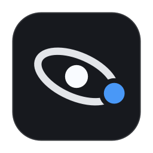
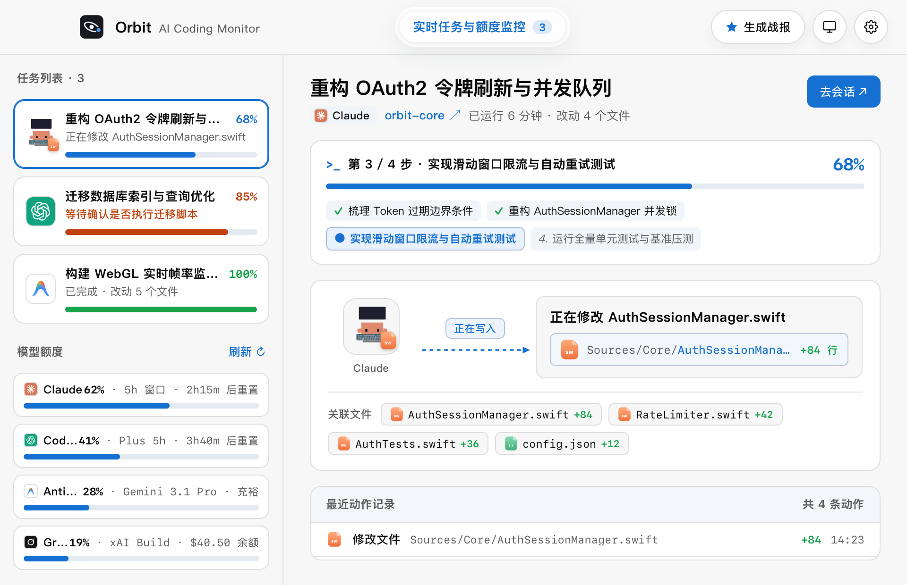
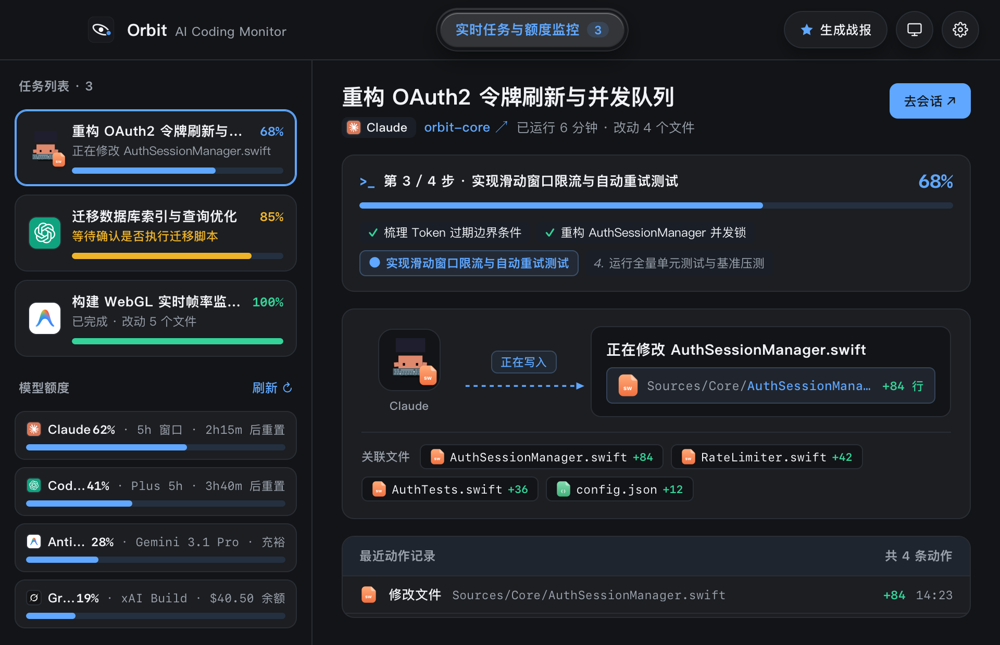
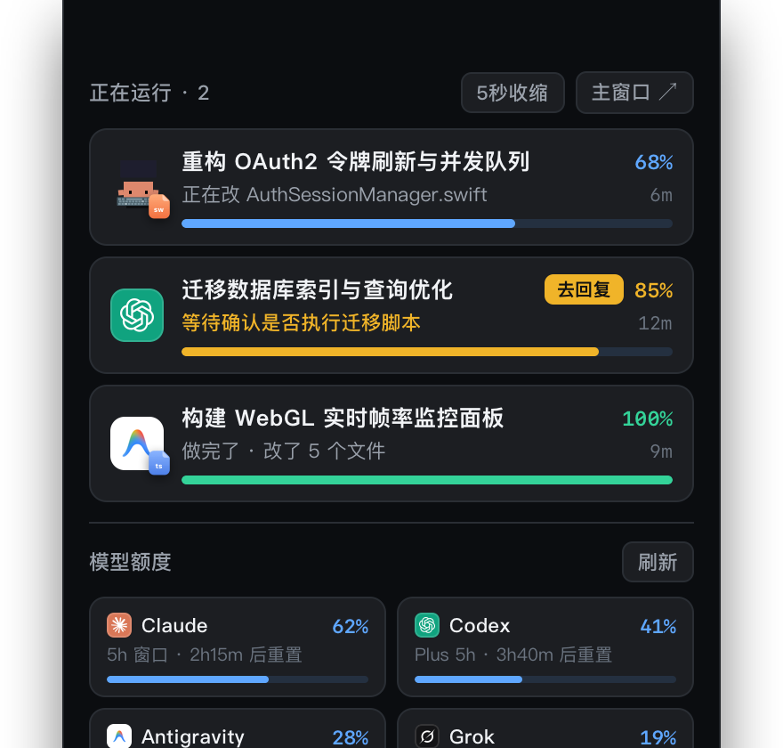
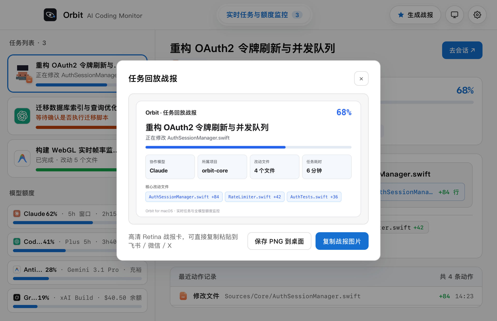

# Orbit (QuotaBar)

<div align="center">



# Orbit · AI Coding Monitor & Notch HUD

**The native Dynamic Island and menu bar HUD for AI coding agents on macOS.**  
Monitor live tasks, file diffs, command executions, and rate limits across **Claude Code**, **OpenAI Codex**, **Google Antigravity**, **xAI Grok Build**, **Cursor**, and **GitHub Copilot** in real time.

[](https://github.com/EA-Studio-SHARK/QuotaBar/releases)
[](https://swift.org)
[](https://github.com/EA-Studio-SHARK/QuotaBar/releases/latest)
[](LICENSE)
[](https://github.com/EA-Studio-SHARK/QuotaBar#privacy-architecture)

[**Download DMG (v1.9.0)**](https://github.com/EA-Studio-SHARK/QuotaBar/releases/latest) · [**Quick Start**](#quick-install) · [**Features**](#features) · [**中文说明**](#简体中文)

</div>

---

<p align="center">
  
  
</p>

<p align="center">
  
  
</p>

---

## ✨ Features

- 🏝️ **MacBook Dynamic Notch HUD**: Hides cleanly inside your physical hardware notch. Expands smoothly upon intentional hover (with a 0.55s dwell threshold to prevent accidental triggers) or instant click. Auto-tucks after 5s or stays pinned.
- ⚡ **Multi-Agent Live Visualizer**: Tracks running AI coding sessions with friendly human summaries, active file diffs (`+84 lines`), terminal commands, subagent calls, and step-by-step progress.
- 🎯 **Interactive Action Buttons**: When an agent requests your approval or confirmation (e.g. asking before executing migrations or file edits), Orbit highlights the session with a golden beacon and gives you a 1-click **"Go Reply"** jump to the terminal or IDE.
- 📊 **Unified Quota & Rate Limit Dashboard**: Visual percentage rings and countdown timers for:
  - **Claude Code**: 5h session windows and weekly rolling limits
  - **OpenAI Codex / ChatGPT**: Plus / Pro usage limits and reset times
  - **Google Antigravity**: Gemini 3.1 Pro quota
  - **xAI Grok Build**: Real-time credit balance
  - **Cursor & GitHub Copilot**: Fast requests and model quotas
- 🎨 **Minimalist Design & Official Icons**: Built with an OKLCH design system, liquid glass tab rails, official brand icons, and customizable retro pixel avatars.
- 📋 **Shareable Replay Battle Cards**: Generate high-res Retina PNG cards summarizing your agent's work session with 1 click to share on Slack, X, or team chats.
- 🔒 **100% Local & Privacy-First**: Runs entirely on your Mac. Zero telemetry, zero external logging servers. Reads credentials only from your existing CLI configurations and system Keychain.

---

## ⚡ Quick Install

### Method 1: Direct Download (Recommended)
Download the latest pre-built `.dmg` or `.zip` from [GitHub Releases](https://github.com/EA-Studio-SHARK/QuotaBar/releases/latest), open it, and drag **QuotaBar.app** into your **Applications** folder.

### Method 2: One-Line Script
```bash
git clone https://github.com/EA-Studio-SHARK/QuotaBar.git
cd QuotaBar
./scripts/install.sh
```

---

## 🛠️ Supported Tools & Detection

| Tool | Live Task Detection | Quota / Rate Limit Source |
|---|---|---|
| **Claude Code** | `~/.claude/projects/` session JSONL & tool events | Claude Keychain / Session API |
| **OpenAI Codex** | `~/.codex/sessions/` transcripts & command execution | `~/.codex/auth.json` / OpenAI API |
| **Google Antigravity** | Workspace agent activity transcripts | Google OAuth token refresh |
| **xAI Grok Build** | Grok CLI background processes & sessions | Grok SSO session / `auth.json` |
| **Cursor** | Cursor editor active workspace state | Cursor `state.vscdb` |
| **GitHub Copilot** | CLI & IDE process telemetry | GitHub CLI (`gh`) / Copilot token |

---

## 🔒 Privacy Architecture

Orbit is designed from day one to be strictly private:
- **No Remote Telemetry**: Orbit does not send your code, project paths, file names, or prompts to any third-party server.
- **Local Read-Only Inspection**: It inspects local session metadata stored by your existing developer CLIs on your own disk.
- **Official API Refresh Only**: Quota queries are made directly from your machine to official provider endpoints (Anthropic, OpenAI, Google, xAI, GitHub) using your existing tokens.

---

<br />

<div id="简体中文"></div>

# 简体中文介绍

**Orbit 是一款专为 macOS 设计的 AI 编程 Agent 实时监控与刘海灵动岛工具。**

在屏幕顶部无缝集成 MacBook 硬件刘海，实时掌握 **Claude Code**、**OpenAI Codex**、**Google Antigravity（反重力）**、**xAI Grok Build**、**Cursor** 以及 **GitHub Copilot** 的实时运行状态、改动文件行数、终端命令、当前进度及模型额度重置倒计时。

### 🌟 核心亮点

1. **灵动刘海 HUD**：平日缩进 MacBook 物理刘海，鼠标悬停停留 0.55 秒或点击展开，支持 5 秒自动收缩与一直常驻两种模式，窗口切换再无误触困扰。
2. **多 Agent 实时追踪**：告别黑盒等待！实时查看 AI 正在改哪个文件（精准显示 `+84 行`）、正在跑什么命令、已运行多少分钟、当前进度百分比。
3. **一键去回复**：当 AI 遇到确认提示（等待你批准执行命令或修改）时，刘海自动亮起黄灯并提供“去回复”跳转按钮，点一下直达对应终端窗口。
4. **全模型额度与倒计时**：全自动检测各家模型额度，直观展示 Claude 5 小时用量与重置倒计时、Codex 配额、Antigravity 额度及 Grok 余额，并提供模型智能切换建议。
5. **极简设计与官方图标**：采用 OKLCH 配色与精致磨砂液态玻璃风格，全面支持深色/浅色/跟随系统模式，可自定义像素小人或官方品牌图标。
6. **一键生成战报卡片**：AI 干完活后，一键生成高清 Retina 战报卡片，支持直接复制图片或保存 PNG 到桌面，方便发送到飞书、微信群或社交平台。
7. **100% 本地隐私安全**：零云端上报、零中转服务器，仅从你本机现有的 CLI 与 IDE 会话文件中提取状态，额度刷新直接请求官方 API。

### 📥 快速安装

1. 前往 [Releases](https://github.com/EA-Studio-SHARK/QuotaBar/releases/latest) 下载最新的 `Orbit-v1.9.0-macOS.dmg`。
2. 打开并将 `QuotaBar.app` 拖入 `Applications`（应用程序）文件夹即可。
3. 启动后，顶部刘海与菜单栏将自动激活，直接开始你的 AI 协作编程之旅！

---

## 📄 License

Orbit is licensed under the [MIT License](LICENSE).
